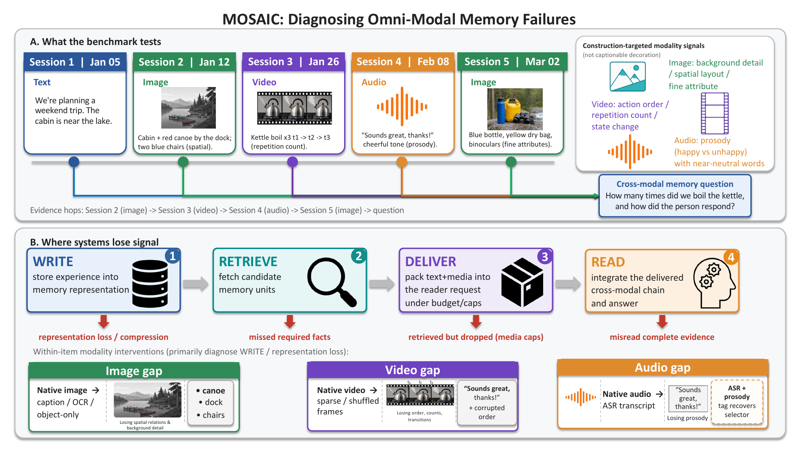

<div align="center">

# MOSAIC

### An omni-modal benchmark for long-term memory

**Remember what was said, shown, and conveyed. Then find where the memory failed.**

[](https://openreview.net/forum?id=juBgXjNvg4)
[](https://huggingface.co/datasets/gzone0111/MOSAIC)
[](https://hkust-knowcomp.github.io/MOSAIC/)
[](https://hkust-knowcomp.github.io/MOSAIC/#leaderboard)

[Overview](#overview) · [Leaderboard](#leaderboard) · [Dataset](#dataset) · [Evaluation](#evaluation)

</div>



The top row is what a question asks the system to remember. The bottom row is where that evidence can be lost: write, retrieve, deliver, and read.

MOSAIC tests whether a conversational agent can use a long history of text, images, video, and audio. A single end-to-end score cannot say where the evidence was lost, so the benchmark holds the question fixed and separates four stages: **write**, **retrieve**, **deliver**, and **read**.

This repository is the evaluation code and the project page. It does not include the benchmark generator. The released set is the frozen 923-question collection.

## Overview

| | |
| --- | ---: |
| Questions | 923 |
| Answerable / refusal | 784 / 139 |
| Personas | 70 |
| Sessions per history | 11–24 |
| Modalities | Text, image, video, audio |

Most answerable questions need more than one fact, and most need more than one modality. The media carry the decision: spatial layout, fine visual detail, video order, or vocal prosody.

| Stage | What it tests |
| --- | --- |
| Write | Whether the history is stored as native media or as a text substitute |
| Retrieve | Whether the right evidence is found |
| Deliver | Whether that evidence actually enters the model request |
| Read | Whether the model answers from the evidence it was given |

Two comparisons use those stages. **Fixed reader** keeps Gemini 3.5 and changes only the memory backend. **End to end** lets each system use its own reader and stack. The fixed-reader track is the diagnosis. The end-to-end track is the deployment-style comparison.

## Leaderboard

The [project page](https://hkust-knowcomp.github.io/MOSAIC/#leaderboard) lists the paper baselines.

- **End to end.** 12 systems on all 923 questions. The top answerable score is ReAct with native multimodal memory and MiMo-V2.5, at 0.732. Correct refusal and false refusal are reported beside it, because refusing everything is not a better memory.
- **Fixed reader.** 7 backends on the 784 answerable questions. A-MEM on caption text leads, at 0.684.

To add a result, open an issue with the [submission form](https://hkust-knowcomp.github.io/MOSAIC/#submit), or file one directly on this repository. Include the system, memory representation, reader, answerable score, and, for an end-to-end run, the correct-refusal and false-refusal rates, plus a link to the code or logs. A checked run is added as a row in [`docs/leaderboard.json`](docs/leaderboard.json).

## Dataset

```bash
hf download gzone0111/MOSAIC --repo-type dataset --local-dir /path/to/mosaic
export MOSAIC_DATA_ROOT=/path/to/mosaic
```

The download matches this layout:

```text
$MOSAIC_DATA_ROOT/
  dataset/stage2_human_filtered/   923 questions
  dataset/media/                   image, audio, video
  dataset/textualized_caption/     caption-text corpus
  dataset/textualized_omni/        omni-text corpus
  indexes/                         RAG, A-MEM, and MemoryOS indexes
  records/protocol_v1/             paper run records
```

Question files still store the original `media_path` strings. The runners map any path containing `clean_output/media/` onto `$MOSAIC_DATA_ROOT/dataset/media/`. The canonical id list in this repository is [`evaluation/manifests/canonical_qids.json`](evaluation/manifests/canonical_qids.json).

## Evaluation

```text
evaluation/
  protocol.py          shared delivery and scoring contract
  rag/                 caption-text, omni-text, and native multimodal RAG
  react/               one-search parity and adaptive ReAct
  amem/                A-MEM
  memoryos/            MemoryOS
  judge/               LLM judge
  experiments/         stage decomposition, modality interventions, paper figures
  manifests/           canonical question ids and fixed-rewrite queries
  configs/             paper-run configs
```

Configs store paths as `${MOSAIC_DATA_ROOT}/...`. The loaders expand that variable when a run starts. New runs write under `$MOSAIC_DATA_ROOT/outputs/` and do not modify `records/`.

Do not put API keys in the JSON configs. Each config names the variable it reads in `api_key_env`. OpenRouter configs also accept `LLM_API_KEY` when `OPENROUTER_API_KEY` is unset. DeepSeek runs read `DEEPSEEK_API_KEY`, and the Gemini runs read `YUNWU_API_KEY`. MemoryOS runs also need the MemoryOS checkout:

```bash
export MEMORYOS_PATH=/path/to/memoryos-pypi
```

Run commands from this repository root. The command list is [`evaluation/EXPERIMENT_RUNBOOK.md`](evaluation/EXPERIMENT_RUNBOOK.md). Conda environment names in that runbook (`omni-emb`, `mm-atlas`, `a-mem`, `memory_os`) are the ones used for the paper runs. Override them with `CONDA_ENV` when your environment names differ.

## Citation

The preprint is forthcoming. Please cite the OpenReview submission until the arXiv record is up:

```bibtex
@misc{tsang2026mosaic,
  title = {{MOSAIC}: An Omni-Modal Benchmark for Long-Term Memory and Cross-Modal Reasoning in Conversational Agents},
  author = {Tsang, Hong Ting and Zhang, Boyi and Huang, Haoyu and Bai, Jiaxin and Li, Yufei and Gao, Yisen and Xie, Zhongwei and Luo, Hongyu and Pan, Jeff Z. and Song, Yangqiu},
  year = {2026},
  url = {https://openreview.net/forum?id=juBgXjNvg4}
}
```
